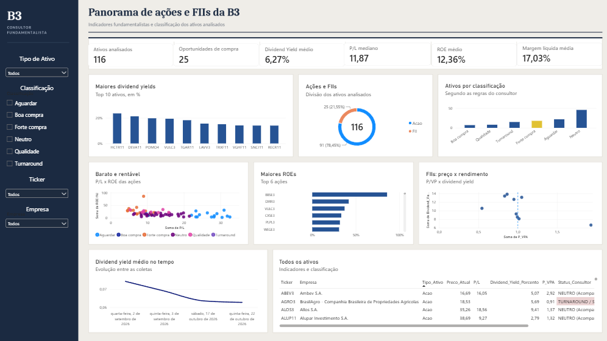

# Consultor Fundamentalista B3

Projeto pessoal em Python que busca indicadores de ações e FIIs da B3, classifica cada ativo com regras simples e joga o resultado num dashboard em Power BI.



## O que ele faz

O robô busca dados de mais de 110 ativos (preço, P/L, P/VP, ROE, margem líquida, EV/EBITDA e dividend yield) no Status Invest e no Yahoo Finance. O dividend yield tem três fontes: se a primeira falha, ele tenta a segunda, e depois a terceira. Se uma requisição de rede falha, ele tenta de novo até 3 vezes.

Depois classifica cada ativo, salva tudo no Excel e no SQL Server, guarda o histórico de cada execução e manda um resumo por e-mail.

## Como classifico

São filtros simples, não um modelo de valuation. Os limites estão na função `get_status` do `analise.py`.

**Ações** (as regras são testadas nesta ordem e vale a primeira que bater)

- Forte compra: P/L entre 0 e 12, dividend yield acima de 5%, margem líquida acima de 10%, dívida líquida/EBITDA abaixo de 2,5 e ROE acima de 15%
- Boa compra: as mesmas regras, sem olhar o ROE
- Aguardar: P/L abaixo de 12 mas dívida acima de 4, ou então P/L acima de 22 ou EV/EBITDA acima de 15
- Turnaround: P/L zero ou negativo
- Qualidade: ROE acima de 20% e P/L abaixo de 18
- Neutro: o resto

**FIIs**

- Forte compra: dividend yield acima de 10% e P/VP entre 0,70 e 1,05
- Boa compra: dividend yield acima de 8% e P/VP até 1,20
- Saudável: dividend yield acima de 6%
- Sem rendimento informado ou baixo rendimento: o resto

No dashboard, agrupei esses três últimos casos de FII em "Neutro".

## Dashboard

O arquivo `Consultor_B3.pbix` lê o `Painel_Consultor.xlsx`. Depois de rodar o robô, abra o Power BI e clique em **Atualizar**. O fundo da página está em `dashboard/fundo_dashboard_b3_v6.png`.

## Tecnologias

- Python (yfinance, pandas, requests, pyodbc)
- SQL Server (histórico na tabela `dbo.historico_financas`)
- Excel (saída do robô e fonte de dados do dashboard)
- Power BI (dashboard)

## Como rodar

```bash
pip install -r requirements.txt
copy .env.example .env
python analise.py
```

Preencha o `.env` com seus dados antes de rodar. O SQL Server e o e-mail são opcionais para testar a coleta, mas o script espera as variáveis do `.env`.

## Estrutura

```
analise.py               script principal (coleta, classificação, Excel, SQL e e-mail)
Painel_Consultor.xlsx    saída do robô, usada pelo dashboard
dashboard/               arquivo .pbix e imagem de fundo
imagens/                 print do dashboard
requirements.txt         dependências
.env.example             modelo das variáveis de ambiente
```

## Limitações conhecidas

- A dívida líquida/EBITDA está vindo zerada na coleta, então as regras que dependem dela ainda não filtram nada.
- Quando um FII não tem P/VP na coleta, o valor fica 0 e ele passa na regra de Boa compra se o dividend yield for alto.
- O dividend yield tem teto de 25% (`LIMITE_DY`), e vários ativos empatam nesse valor.
- Os dados vêm de fontes públicas e podem ter falhas ou atrasos.

## Aviso

Projeto de estudo. Nada aqui é recomendação de investimento.
